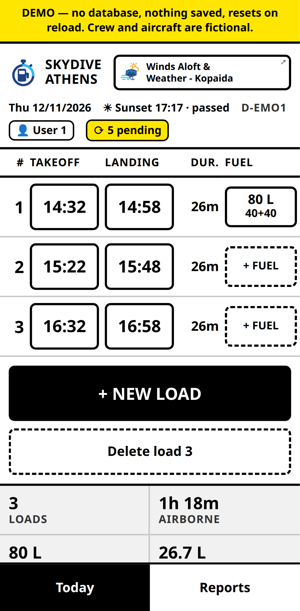
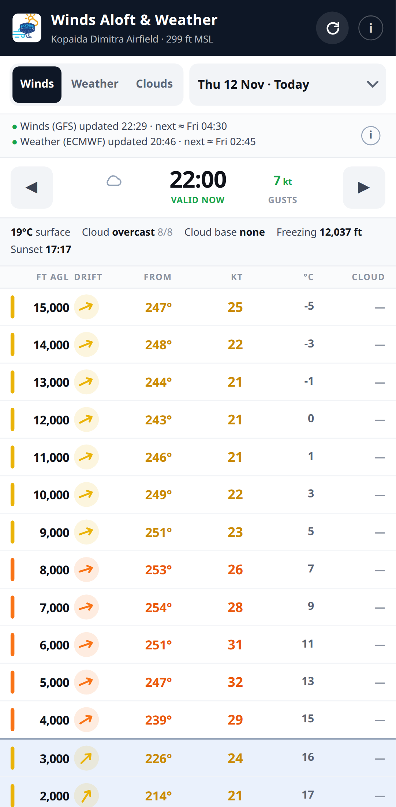

<!--
  SHARED FILE — three agent sessions maintain this README.
  One looks after the Ground app, one after Winds Aloft & Weather, and one
  after DevOps Mutant Powers.
  Both commit as the same author, so the log cannot tell you who wrote what.

  PROTOCOL
  1. git pull --rebase  immediately before every push. Never force-push.
  2. Edit ONLY inside your own blocks. Blocks are delimited by HTML comments
     whose names carry the app: "ground:card", "ground:prose", "winds:card",
     "winds:prose", each with a :start and an :end. Each app owns two.
     DevOps Mutant Powers owns one, "dmp", with "dmp:start" and "dmp:end".
  3. Everything outside those blocks is shared. Change it only when it is
     genuinely about your app, and never reformat the other block.
  4. If a push is rejected, read the other side's commit before rebasing.
-->

# Nikos Pavlopoulos

DevOps engineer — I run Kubernetes, GitOps, PostgreSQL, identity and observability in production, and keep a
journal of every incident, post-mortem and lesson along the way. Software developer by training (Java and Spring
Boot, most recently TypeScript on Cloudflare Workers), backed by 10+ years of analytical and customer-facing work
in multinational environments.

📄 [Resume](https://resume.nikospavlopoulos.com) · 📩 Contact me via the email in my profile info

---

<!-- dmp:start -->
<a href="https://github.com/nikospavlopoulos/devops-mutant-powers">
  <picture>
    <source media="(prefers-color-scheme: dark)" srcset="https://raw.githubusercontent.com/nikospavlopoulos/assets/main/devops-mutant-powers/hero-dark.svg">
    <source media="(prefers-color-scheme: light)" srcset="https://raw.githubusercontent.com/nikospavlopoulos/assets/main/devops-mutant-powers/hero-light.svg">
    
  </picture>
</a>

## DevOps Mutant Powers — my open-source plugin for AI coding agents

AI coding agents are fast, and in infrastructure speed without discipline breaks things: a command run against the
wrong cluster, a fix guessed from half an error message, "done" declared before anything was checked.
**DevOps Mutant Powers** gives them the habits of a careful DevOps engineer instead. Its 45 skills make the agent
design before it builds, debug from evidence, name the target of every command, ask before any live change, never
print a secret, and prove a fix through the real user path before calling it done.

The knowledge comes from my own work: about 300 journal entries (incident notes, post-mortems and learning notes)
from running Kubernetes, GitOps, PostgreSQL, identity and observability in production, each rewritten as generic
guidance and checked against the official documentation. Its effect is measured with an eval suite run with and
without the plugin, and the results are published, including the cases where it adds nothing.

<table width="100%">
<tr>
<td align="center" width="20%"><a href="https://github.com/nikospavlopoulos/devops-mutant-powers#workflow"><picture><source media="(prefers-color-scheme: dark)" srcset="https://raw.githubusercontent.com/nikospavlopoulos/assets/main/devops-mutant-powers/badges/workflow-on-dark.svg"></picture><br><b>Workflow</b></a><br><sub>12 skills</sub></td>
<td align="center" width="20%"><a href="https://github.com/nikospavlopoulos/devops-mutant-powers#debugging-and-incidents"><picture><source media="(prefers-color-scheme: dark)" srcset="https://raw.githubusercontent.com/nikospavlopoulos/assets/main/devops-mutant-powers/badges/debugging-and-incidents-on-dark.svg"></picture><br><b>Debugging and incidents</b></a><br><sub>3 skills</sub></td>
<td align="center" width="20%"><a href="https://github.com/nikospavlopoulos/devops-mutant-powers#platform"><picture><source media="(prefers-color-scheme: dark)" srcset="https://raw.githubusercontent.com/nikospavlopoulos/assets/main/devops-mutant-powers/badges/platform-on-dark.svg"></picture><br><b>Platform</b></a><br><sub>6 skills</sub></td>
<td align="center" width="20%"><a href="https://github.com/nikospavlopoulos/devops-mutant-powers#delivery"><picture><source media="(prefers-color-scheme: dark)" srcset="https://raw.githubusercontent.com/nikospavlopoulos/assets/main/devops-mutant-powers/badges/delivery-on-dark.svg"></picture><br><b>Delivery</b></a><br><sub>5 skills</sub></td>
<td align="center" width="20%"><a href="https://github.com/nikospavlopoulos/devops-mutant-powers#network-and-edge"><picture><source media="(prefers-color-scheme: dark)" srcset="https://raw.githubusercontent.com/nikospavlopoulos/assets/main/devops-mutant-powers/badges/network-and-edge-on-dark.svg"></picture><br><b>Network and edge</b></a><br><sub>5 skills</sub></td>
</tr>
<tr>
<td align="center" width="20%"><a href="https://github.com/nikospavlopoulos/devops-mutant-powers#data"><picture><source media="(prefers-color-scheme: dark)" srcset="https://raw.githubusercontent.com/nikospavlopoulos/assets/main/devops-mutant-powers/badges/data-on-dark.svg"></picture><br><b>Data</b></a><br><sub>2 skills</sub></td>
<td align="center" width="20%"><a href="https://github.com/nikospavlopoulos/devops-mutant-powers#security-and-identity"><picture><source media="(prefers-color-scheme: dark)" srcset="https://raw.githubusercontent.com/nikospavlopoulos/assets/main/devops-mutant-powers/badges/security-and-identity-on-dark.svg"></picture><br><b>Security and identity</b></a><br><sub>3 skills</sub></td>
<td align="center" width="20%"><a href="https://github.com/nikospavlopoulos/devops-mutant-powers#cloud-and-observability"><picture><source media="(prefers-color-scheme: dark)" srcset="https://raw.githubusercontent.com/nikospavlopoulos/assets/main/devops-mutant-powers/badges/cloud-and-observability-on-dark.svg"></picture><br><b>Cloud and observability</b></a><br><sub>2 skills</sub></td>
<td align="center" width="20%"><a href="https://github.com/nikospavlopoulos/devops-mutant-powers#code-quality"><picture><source media="(prefers-color-scheme: dark)" srcset="https://raw.githubusercontent.com/nikospavlopoulos/assets/main/devops-mutant-powers/badges/code-quality-on-dark.svg"></picture><br><b>Code quality</b></a><br><sub>2 skills</sub></td>
<td align="center" width="20%"><a href="https://github.com/nikospavlopoulos/devops-mutant-powers#meta"><picture><source media="(prefers-color-scheme: dark)" srcset="https://raw.githubusercontent.com/nikospavlopoulos/assets/main/devops-mutant-powers/badges/meta-on-dark.svg"></picture><br><b>Meta</b></a><br><sub>5 skills</sub></td>
</tr>
</table>

**Install in Claude Code**

```text
/plugin marketplace add nikospavlopoulos/devops-mutant-powers
/plugin install devops-mutant-powers@devops-mutant-powers
```

Also for Codex, Cursor, Antigravity and OpenCode · **[Repository](https://github.com/nikospavlopoulos/devops-mutant-powers)** · **[Release v2.2.0](https://github.com/nikospavlopoulos/devops-mutant-powers/releases/tag/v2.2.0)** ·
**[How it's built](https://github.com/nikospavlopoulos/devops-mutant-powers/blob/main/docs/how-its-built.md)** · **[Eval results](https://github.com/nikospavlopoulos/devops-mutant-powers/blob/main/evals/RESULTS.md)**

`Claude Code plugin` `Agent Skills` `Kubernetes` `Flux` `Terraform` `PostgreSQL` `GitHub Actions` `Copybara`
<!-- dmp:end -->

---

## Skydive Athens — production software for a dropzone

I am a licensed USPA skydiver and a certified skydiving coach, and I work ground
crew at a dropzone in Boeotia, Greece. I built both of these on my own initiative,
pro bono, to fix problems I kept running into there. Both are live, and both are
used on operating days.

<table width="100%">
<tr>
<td width="50%" valign="top" align="center">
<!-- ground:card:start -->

### Ground — fuel and flight log



**[▶ Try the demo](https://ground-demo.skydive-athens.com)**<br>
**[Case study and runnable code](https://github.com/nikospavlopoulos/sd-ground-demo)**

<!-- ground:card:end -->
</td>
<td width="50%" valign="top" align="center">
<!-- winds:card:start -->

### Winds Aloft &amp; Weather



**[▶ Open the app](https://winds.skydive-athens.com)**<br>
**[Case study and runnable code](https://github.com/nikospavlopoulos/sd-winds-demo)**

<!-- winds:card:end -->
</td>
</tr>
</table>

<!-- ground:prose:start -->

**Ground** records every load the jump aircraft flies and every litre of fuel that
goes into it, replacing a phone note that was retyped from scratch every day and
whose totals were mental arithmetic between loads. The client is authoritative, so
a tap registers the moment it happens and survives a dropout while the crew move
around the zone. Totals are derived on read and never stored.

`TypeScript` `Preact` `Hono` `Cloudflare Workers` `D1 / SQLite` `Vitest` `Playwright`

<!-- ground:prose:end -->

<!-- winds:prose:start -->

**Winds Aloft & Weather** gives the wind every 1,000 ft from the surface to
15,000 ft **above the field** — the way an altimeter reads it, not above sea
level — with a drift arrow pointing where the wind will carry you. Five days,
scrubbed hour by hour with no further requests, plus surface weather from three
forecast models and cloud by height from two.

`TypeScript` `Preact` `Hono` `Cloudflare Workers` `Open-Meteo` `Vitest` `Playwright`

<!-- winds:prose:end -->

---

## Earlier work

- **[Skydiving Logbook REST API](https://github.com/nikospavlopoulos/skydivinglogbook-spring-rest)**
  [](https://github.com/nikospavlopoulos/skydivinglogbook-spring-rest/actions/workflows/test-workflow.yml)
  — log and manage skydiving jumps, with role-based access. Java, Spring Boot,
  Spring Data JPA, JWT via custom Spring Security filters, MySQL and H2,
  multi-stage Docker, CI running JUnit and integration tests at 95% coverage.
  [Video demo](https://youtu.be/ddpZyq2-30Q?si=0WPRMsWgoW6kFFLE).
- **[Skydiving Logbook — Thymeleaf](https://github.com/nikospavlopoulos/skydivinglogbook-spring-thymeleaf)**
  — my first full-stack project, and the REST API's predecessor.
- **[Airplane Crash Analysis](https://github.com/nikospavlopoulos/plane_crashes_R)**
  — long-term trends in airplane crashes and fatalities, cleaned, analysed and
  visualised in R.
- **[ProudSalesPro](https://github.com/nikospavlopoulos/proudsalespro)**
  — self-hosted WordPress blog on professional sales, 2012–2022. Ranked on
  Google's first page for two Greek search terms between 2014 and 2020.
- **[Traditional vs Agile](https://gist.github.com/nikospavlopoulos/f60bc9ad46a3d53a1b9818184592c50e)**
  — a 45-minute class presentation from a project-management programme at New
  York College, Athens.

---

#### Also

A fanatic Ubuntu and Firefox user. I like jumping out of perfectly good
airplanes, rock climbing, Lindy Hop, and Toastmasters — and there is a
[Scratch skydive project](https://scratch.mit.edu/projects/1140480389) too.
